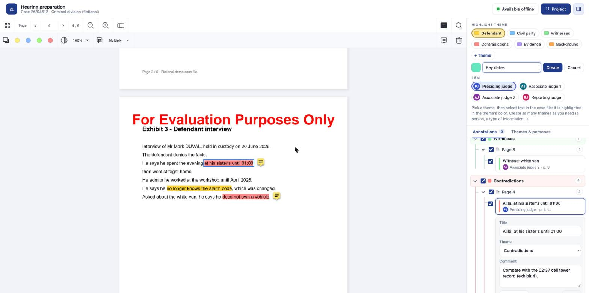

# Hearing Annotations PoC

Judges prepare PDF case files for court hearings with [Nutrient Web SDK](https://www.nutrient.io/sdk/web/). They create their own themes (a person in the case, a type of information…), give each one a color, and highlight and comment in that theme's color. They move through the file from a navigation tree, share a direct link to a note, choose what the courtroom sees when the file is projected, and keep working with no network.



## What it does

- **Themes set the color.** Pick a theme, select text, and the highlight takes the theme's color. Themes are free: a person (defendant, victim, witness) or a type of information (contradictions, evidence, key dates…). "+ Theme" creates one with a name and a color in one step; the *Themes & personas* tab renames, recolors and deletes them. Changing a theme's color updates all its highlights, and moving a highlight to another theme gives it that theme's color.
- **Personas record the author.** "I am" sets who wrote the annotation (name and initials in the tree). Personas do not set the color.
- **Navigation tree.** The right panel shows the annotations as a tree: theme, then page, then annotation. You can also group by persona then theme, or by page then theme. Branches fold and unfold, and the tree can be searched. Click an annotation to jump to it in the document.
- **Show or hide from the tree.** Every branch and every annotation has a checkbox. Unticking hides the highlights in the document. A branch with some items hidden shows a partial tick and a count such as `2/5`. "Show all" and "Hide all" act on everything.
- **Inline editing.** Title, category and comment are edited under the selected annotation.
- **Share links.** "Share" (top bar) copies a link to the case file with all its annotations. "Copy link" (under an annotation) copies a link that opens the file on that annotation. Both work for anyone: the annotations, with the themes and personas they use, travel compressed in the link hash (`/?lang=fr&doc=…#a=<id>&s=<payload>`), so the person who opens it gets them in their own browser and the viewer scrolls to the annotation. The hash is never sent to the server.
- **Projection mode.** "Project" opens a dialog to choose what the courtroom sees: no annotations, only the ones ticked in the tree, or all of them. You also choose whether to show the comments and the toolbar. The panels are always hidden. "Change" adjusts the choice during the projection, and Esc or "Exit projection" comes back. The saved annotations are never changed.
- **Resizable, responsive panel.** Drag the panel's left edge to resize it (double-click resets it), or hide it with the button at the top right. Below 1024 px wide (tablets), the panel becomes a drawer that slides over the document.
- **Offline.** "Prepare offline" downloads every file the app needs (app shell, SDK runtime, case files: about 20 MB, listed in `offline-manifest.json` at build time) into the service worker cache, with progress in the button. Annotations, themes and personas are saved in IndexedDB. The file then opens and can be annotated with no network. When a new version is deployed, the cache is refreshed in the background. Hover the button for one second to see the explanation.
- **Languages.** English by default, French available (`VITE_DEFAULT_LANG=fr`, or `?lang=fr` in the URL). Each language has its own demo data and sample file.


## How it works

| Need | Implementation |
| --- | --- |
| Viewer and highlights | `NutrientViewer.load()` in standalone (WebAssembly) mode, `text-highlighter` tool and the text selection popup |
| Theme color and author | `setAnnotationPresets()` with the current theme's color and `setAnnotationCreatorName()` with the current persona; `annotations.create` adds `customData` (`personaId`, `categoryId` = theme, `label`) |
| Navigation tree | `getAnnotations()` on every page, grouped in two levels in the custom side panel; `jumpToRect()` and `setSelectedAnnotations()` on click |
| Show or hide | Tree checkboxes set the annotation `noView` flag, saved with the annotations |
| Comments | The annotation `note` property |
| Share links | `Annotations.toSerializableObject()` of the shared annotations, deflate-compressed (`CompressionStream`) and base64url-encoded in the URL hash; on open, `fromSerializableObject()` then `create()` or `update()`, saved, then `jumpToRect()` on the annotation |
| Projection | Snapshot of `noView` and `note`, then the chosen visibility applied with `update()`; restored on exit and never saved. Toolbar shown or hidden with `setViewState()` |
| Persistence | `exportInstantJSON()` saved per document in IndexedDB, reloaded with the `instantJSON` option |
| Offline | A Vite plugin writes `offline-manifest.json` (every built file except the Office conversion runtime); the button caches them all. `public/sw.js`: cache first for SDK and app assets, network first for the page and case files |

Code layout:

- `src/main.js`: viewer, tree, projection, offline
- `src/panel.js`: panel resize, show/hide and tablet drawer
- `src/config.js`: default themes, personas, documents and demo annotations per language
- `src/store.js`: IndexedDB persistence
- `src/tooltip.js`: tooltips shown after a 1-second hover
- `src/i18n.js`: UI strings (English and French)
- `scripts/make_sample.py`: generates the fictional sample case files, for example `python3 scripts/make_sample.py en public/samples/criminal-case-file-sample.pdf`

The sample files in `public/samples/` are fictional. Every name and fact in them is invented.

## Prerequisites

- Node.js 18 or later
- A Nutrient Web SDK license key for licensed use (optional: without one the SDK runs in evaluation mode with a watermark)

## Environment variables

Copy `.env.example` to `.env`:

| Variable | Description |
| --- | --- |
| `VITE_NUTRIENT_LICENSE_KEY` | Nutrient Web SDK license key. Leave empty for evaluation mode. |
| `VITE_DEFAULT_LANG` | Default UI language and demo data: `en` (default) or `fr`. |

## Build and run

```bash
npm install
npm run build
npm run preview
```

Open http://localhost:4173. `npm install` copies the SDK runtime into `public/nutrient-viewer-lib`.

`npm run dev` also works for development, but offline mode needs the production build (`build` and `preview`), because the service worker is only registered there.

To go back to the demo data, use "Reset demo" in the *Themes & personas* tab, or open `/?reset=1`.

## Limits of the PoC

- Annotations are stored in the browser of each workstation. Share links copy them to another browser at the time of sharing; they do not sync later changes. Real-time sharing between judges needs a server-side store (for example Nutrient Document Engine, or an existing backend storing Instant JSON). Links carrying hundreds of annotations also get long.
- Personas are chosen in the app. In production they would come from the identity provider.
- AI-assisted analysis with an on-premise LLM is not part of this PoC.
