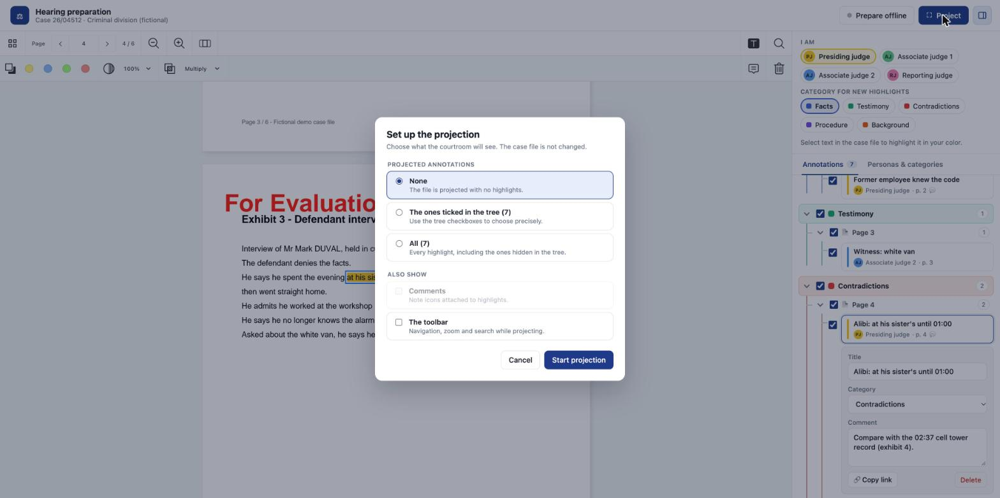

# Hearing Annotations PoC

Judges prepare PDF case files for court hearings with [Nutrient Web SDK](https://www.nutrient.io/sdk/web/). Each judge highlights and comments in their own color and sorts the notes into categories. They move through the file from a navigation tree, share a direct link to a note, choose what the courtroom sees when the file is projected, and keep working with no network.


## What it does

- **Personas with their own color.** Pick who you are ("I am"), select text, and the highlight takes your color and name. Personas are created, renamed, recolored and deleted in the *Personas & categories* tab. Changing a color updates that persona's existing highlights.
- **Categories.** Each new highlight goes into the selected category. Categories have their own color and are managed the same way.
- **Navigation tree.** The right panel shows the annotations as a tree: category, then page, then annotation. You can also group by persona then category, or by page then category. Branches fold and unfold, and the tree can be searched. Click an annotation to jump to it in the document.
- **Show or hide from the tree.** Every branch and every annotation has a checkbox. Unticking hides the highlights in the document. A branch with some items hidden shows a partial tick and a count such as `2/5`. "Show all" and "Hide all" act on everything.
- **Inline editing.** Title, category and comment are edited under the selected annotation.
- **Direct links.** "Copy link" copies a URL such as `/?doc=criminal-case-sample#a=seed-alibi` that opens the file on that annotation.
- **Projection mode.** "Project" opens a dialog to choose what the courtroom sees: no annotations, only the ones ticked in the tree, or all of them. You also choose whether to show the comments and the toolbar. The panels are always hidden. "Change" adjusts the choice during the projection, and Esc or "Exit projection" comes back. The saved annotations are never changed.
- **Resizable, responsive panel.** Drag the panel's left edge to resize it (double-click resets it), or hide it with the button at the top right. Below 1024 px wide (tablets), the panel becomes a drawer that slides over the document.
- **Offline.** "Prepare offline" stores the app, the SDK and the case file in the browser with a service worker. Annotations, personas and categories are saved in IndexedDB. The file then opens and can be annotated with no network. Hover the button for one second to see the explanation.
- **Languages.** English by default, French available (`VITE_DEFAULT_LANG=fr`, or `?lang=fr` in the URL). Each language has its own demo data and sample file.



## How it works

| Need | Implementation |
| --- | --- |
| Viewer and highlights | `NutrientViewer.load()` in standalone (WebAssembly) mode, `text-highlighter` tool and the text selection popup |
| Persona color and name | `setAnnotationPresets()` and `setAnnotationCreatorName()` when the persona changes; `annotations.create` adds `customData` (`personaId`, `categoryId`, `label`) |
| Navigation tree | `getAnnotations()` on every page, grouped in two levels in the custom side panel; `jumpToRect()` and `setSelectedAnnotations()` on click |
| Show or hide | Tree checkboxes set the annotation `noView` flag, saved with the annotations |
| Comments | The annotation `note` property |
| Direct links | Annotation IDs in the URL hash, resolved on load and on `hashchange` |
| Projection | Snapshot of `noView` and `note`, then the chosen visibility applied with `update()`; restored on exit and never saved. Toolbar shown or hidden with `setViewState()` |
| Persistence | `exportInstantJSON()` saved per document in IndexedDB, reloaded with the `instantJSON` option |
| Offline | `public/sw.js`: cache first for SDK and app assets, network first for the page and case files |

Code layout:

- `src/main.js`: viewer, tree, projection, offline
- `src/panel.js`: panel resize, show/hide and tablet drawer
- `src/config.js`: default personas, categories, documents and demo annotations per language
- `src/store.js`: IndexedDB persistence
- `src/tooltip.js`: tooltips shown after a 1-second hover
- `src/i18n.js`: UI strings (English and French)
- `scripts/make_sample.py`: generates the fictional sample case files, for example `python3 scripts/make_sample.py en public/samples/criminal-case-file-sample.pdf`

The sample files in `public/samples/` are fictional. Every name and fact in them is invented.

## Prerequisites

- Node.js 18 or later
- A Nutrient Web SDK license key for licensed use (optional: without one the SDK runs in evaluation mode with a watermark)

## Environment variables

Copy `.env.example` to `.env`:

| Variable | Description |
| --- | --- |
| `VITE_NUTRIENT_LICENSE_KEY` | Nutrient Web SDK license key. Leave empty for evaluation mode. |
| `VITE_DEFAULT_LANG` | Default UI language and demo data: `en` (default) or `fr`. |

## Build and run

```bash
npm install
npm run build
npm run preview
```

Open http://localhost:4173. `npm install` copies the SDK runtime into `public/nutrient-viewer-lib`.

`npm run dev` also works for development, but offline mode needs the production build (`build` and `preview`), because the service worker is only registered there.

To go back to the demo data, use "Reset demo" in the *Personas & categories* tab, or open `/?reset=1`.

## Limits of the PoC

- Annotations are stored in the browser of each workstation. Sharing them between judges, and direct links that work on another computer, need a server-side store (for example Nutrient Document Engine, or an existing backend storing Instant JSON).
- Personas are chosen in the app. In production they would come from the identity provider.
- AI-assisted analysis with an on-premise LLM is not part of this PoC.
